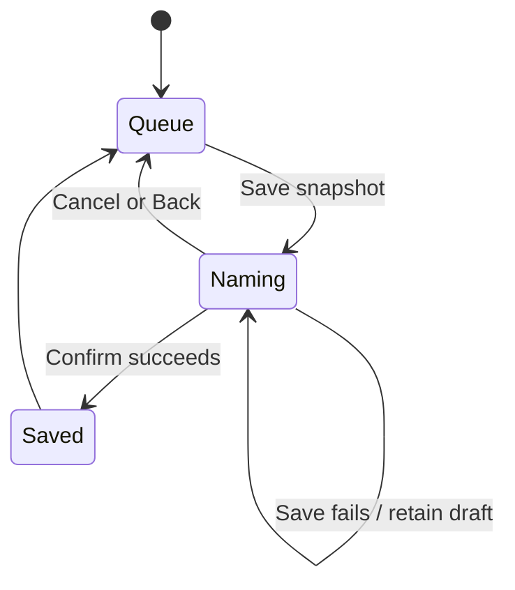

# Design

## Context

See `proposal.md` for motivation. The queue-save snapshot is already captured when the name dialog opens, but the Queue content and its local draft are removed when playback identity changes and the player presentation resets its selected panel. The feature queue also reads `LocalHausWindowOverlayPublisher` directly, although Shared installs the host. Library/Search rows have separate action surfaces; the Library row's normal-mode accessible description currently says Select while activation plays. Search has no metadata-edit callback/menu. The Library detail path uses a literal 720dp check while root density is already projected by `LocalHausDesktopDensity` and redundantly threaded through route and row adapters.

The active `studio-ui-redesign` deltas already define the 48dp mobile / 44pt iOS action minimums and shared adaptive-density policy. This follow-up will implement those requirements, not introduce a duplicate design-system capability. The 2026-08-10 Library extraction design remains historical; the current redesigned public API becomes the binding contract after explicit source/caller migration.

## Goals / Non-Goals

**Goals:**

- Preserve the active Queue surface, its save dialog, immutable queue snapshot, name draft, and confirmation state while the current occurrence advances to another track.
- Keep queue ownership, playback state, and Back precedence unchanged; preserve existing explicit dismissal, route invalidation, failure, retry, and empty-queue behavior.
- Make Library and Search secondary row actions named, localized, reachable without long press, and accurately exposed to assistive technology.
- Keep feature dependencies callback/entry-point-first; no feature obtains Shared shell state from a CompositionLocal service locator.
- Use the root's existing window-density projection for row density instead of feature-level duplicate thresholds and boolean threading.
- Reconcile the public Library API and resource ledgers with the accepted redesigned source contract.

**Non-Goals:**

- No new queue authority, queue persistence, database changes, navigation stack, Back policy, scan/playback behavior, or metadata storage changes.
- No broad refactor of repeated navigation destinations, BrowseMode switches, duplicate queue-row policy, or the `HausSongRow` parameter cluster.
- No user-only GUI/device/audio acceptance; existing manual tasks remain postponed and unchecked.

## Decisions

### Preserve Queue presentation state at the owning shell

When a new current track arrives while the Queue panel is active, Shared SHALL retain Queue as the active panel. `PlaybackQueueContent` remains composed, so its already-captured immutable save draft and confirmation state survive; do not lift a second queue snapshot or name draft into a new owner. A track-bound Lyrics panel may continue to reset according to its existing behavior. A transition to no current queue occurrence and explicit route invalidation continue to use existing behavior.

Back remains ordered through the existing shared dismissal contract: close the top dialog first, then Queue. The queue save operation continues to persist exactly the snapshot taken at dialog opening.

### Pass the overlay publisher through the Shared entry point

Shared resolves the installed window-overlay publisher and supplies it as a required argument when composing Queue content. The playlist feature SHALL NOT read `LocalHausWindowOverlayPublisher`; it receives only the publisher contract needed to present its modal content. Keep the current outside-pane modal placement and shared Back/focus settlement behavior.

### Use one named secondary row-action surface

Use the existing feature row-menu pattern for a localized More actions menu on eligible Library and Search rows. Normal-mode actions include Select; Edit metadata appears only when the Shared owner supplies the existing editor callback. Preserve inline favorite actions and normal row playback. Selection mode retains the existing checkbox/row-toggle behavior and removes unavailable menu actions from pointer, gesture, and accessibility input.

Separate the row's accessible track identity from the long-press/Select action label. A normal-mode row must not be announced as Select when its activation plays. Search menu callbacks carry the stable track ID to the existing Shared metadata-editor owner; cancel/save retain current editor and playback semantics.

### Centralize density at the root

`AppShellLayout` remains the single provider of `LocalHausDesktopDensity`. `LibraryAppShell` and Library leaves consume that projection instead of recalculating it from a second width threshold. Remove redundant `desktopDensity` threading through Library route/row adapters where the leaf can read the existing local. Keep `WIDE_LIBRARY_BREAKPOINT_DP` only for Library's content-layout decisions; it no longer selects song-row density. Do not change app navigation breakpoints.

### Meet the existing action-target policy

Replace fixed 36dp heights on the affected clear-library and remove-missing actions with a minimum interactive height of 48dp using a size constraint that can grow with text. This satisfies the existing 48dp mobile and 44pt iOS minimums with one shared policy; the dialogs may grow/scroll rather than truncate enlarged labels.

### Make current API and ledgers authoritative

Record the current Library declarations, including `BrowseMode`, `LibrarySharedLabels`, Home and Detail parameters/defaults, and all 12 current label members in the new SDD design. Update `docs/architecture.md` and the feature-first OpenSpec delta to point at that contract; update the resource ledger for the current Library labels and Settings key `settings_section_sources`. Do not edit the 2026-08-10 extraction design or add aliases/defaulted compatibility parameters solely to match it. Keep the existing EN/ZH visible wording unchanged.

### Remove unused queue helper state without weakening behavior coverage

Delete `executeQueueMutation` and the unread `reservesMetadataWidth` field. Move any meaningful assertions from helper-only tests to the existing production Shared/feature queue mutation path; retain tests only for consumer-visible outcome, feedback, and state preservation.

## Risks / Trade-offs

- **Queue remains open across a track change** → Limit retention to an already-active Queue panel; do not alter explicit Back, close, no-current, or route-invalidation behavior.
- **More menu adds row chrome** → Keep it secondary, localized, and present only where actions exist; do not make inactive or obscured controls interactive.
- **Root density can differ from a pane's local width** → Use the established app-wide window projection consistently; reserve the Library 720dp breakpoint for content layout only.
- **48dp minimum increases dialog height** → Use minimum rather than fixed height and allow the dialog content to scroll at short viewport or enlarged text.
- **Library API contract update changes a public feature signature** → Migrate all in-repository callers in one checkpoint, update exact contract ledgers, and add no compatibility shim. No persisted data changes, so rollback is a code/documentation revert.
- **Existing extraction design will differ from current source** → Preserve it as historical baseline and explicitly identify the newer binding contract in architecture/OpenSpec rather than silently editing history.

## Migration Plan

1. Update the behavioral/spec contract deltas and exact API/resource ledger before implementation.
2. Change Shared Queue state and its explicit overlay argument together; update all call sites and production-boundary regression coverage.
3. Update Library/Search row actions and semantics, then apply root density and dialog target policy; remove dead helper code after production-path tests cover its behavior.
4. Reconcile `docs/architecture.md` and `docs/adr/0001-feature-first-module-boundaries.md`; run OpenSpec validation, focused JVM tests, and the repository's required platform verification before marking implementation tasks complete.

No database migration, user data migration, or runtime cutover is required.

## Open Questions

None. Manual visual/device/audio acceptance remains a user-owned postponed item, not an unresolved design decision.
